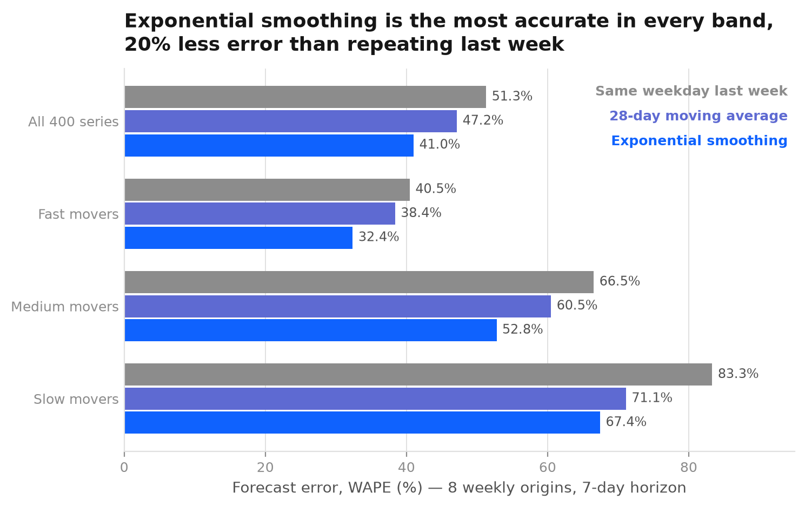
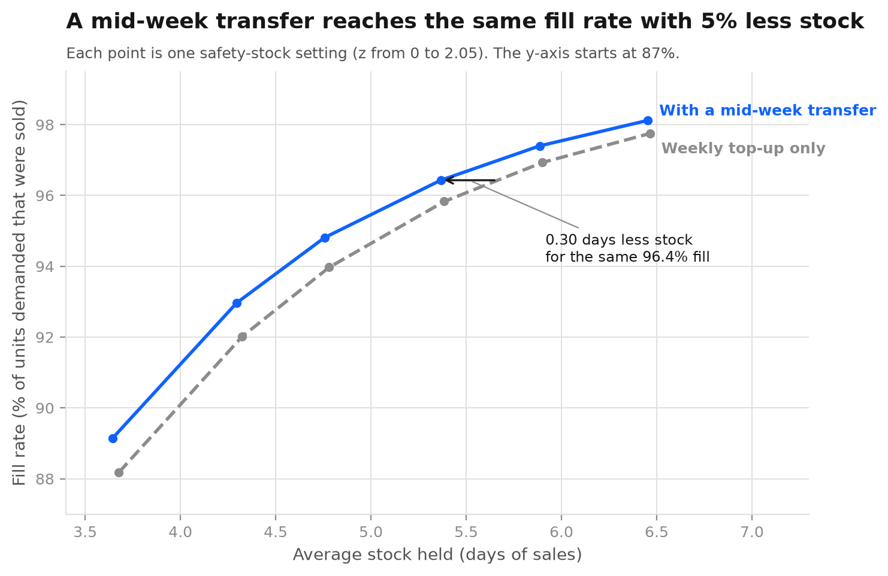
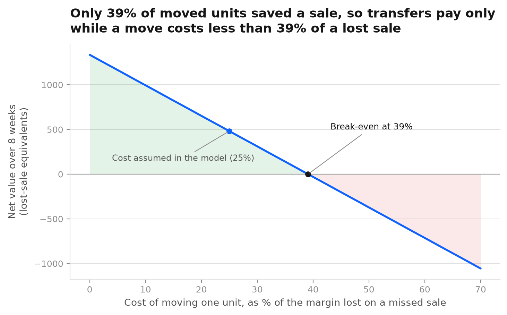
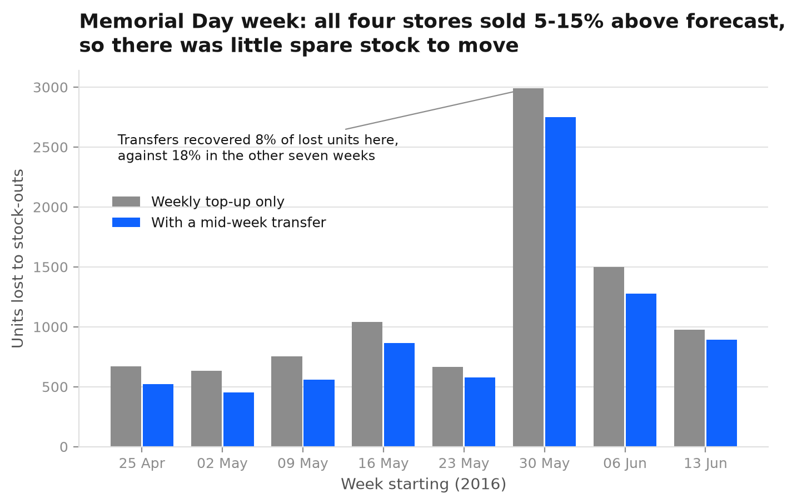

# Dark-Store Availability & Redistribution

Four stores in one city, 100 fast-moving grocery items. Each store is topped up once a
week. Midway through the week some stores are running out while others hold more than
they will sell. Is it worth moving stock between them, and when?

The stores are real: Walmart's four California stores (CA_1 to CA_4) in the public
[M5 dataset](https://www.kaggle.com/competitions/m5-forecasting-accuracy), with two years
of daily unit sales. They stand in for a quick-commerce dark-store cluster because no
dark-store operator publishes store-by-item sales.

## What it finds

Scored on eight weeks the models never saw (25 April to 19 June 2016):

| | |
|---|---|
| Best forecast | Exponential smoothing with a weekday profile: 41.0% WAPE, against 47.2% for a 28-day moving average and 51.3% for "same weekday last week" |
| Lost units, weekly top-up only | 9,228 of 221,065 demanded (95.8% fill rate) |
| Lost units, with a mid-week transfer | 7,892 (96.4% fill rate), 14.5% fewer |
| Stock moved to get there | 3,416 units over 720 item-lane-weeks, 4.7 units per move |
| Same fill rate without transfers | needs 5.67 days of stock instead of 5.37, about 6% more |
| Break-even | only 39% of moved units saved a sale, so transfers pay while a move costs less than 39% of the margin on a lost sale |

These results are at a 90% safety-stock setting (z = 1.28). The full curve for six settings is
in `output/tables/service_curve.csv`.

The week of Memorial Day (30 May) lost the most units by far. All four stores sold 5% to 15%
above forecast that week, the only week in the test where that happened. With every store
short at once, transfers recovered 8% of lost units, against 18% in the other seven weeks.
Redistribution fixes local mistakes. It does not fix a forecast that is wrong everywhere.









## How it works

**Forecast.** Three methods forecast each of the 400 store-item series seven days ahead from
eight weekly origins. A method only sees days before its origin. Exponential smoothing takes a
weekday profile from the last 52 weeks and smooths the level, choosing its smoothing weight per
series by one-step-ahead error on the training window.

**Replenishment.** At each origin, every store orders up to the week's forecast plus a safety
stock of z × σ × √7, where σ is the standard deviation of the smoothing model's one-step errors.
Leftover stock carries into the next week.

**Transfer.** After three days of selling, a linear program re-plans each item across the four
stores (`src/redistribute.py`, `plan_transfers`). It moves a unit only from a store holding more
than its forecast need for the rest of the week to one holding less, and only when a lost sale
costs more than the move. The plan is then tested against what customers actually bought.

```
pip install -r requirements.txt
python3 src/fetch_data.py       # downloads M5 (about 78 MB, not committed) and checks its SHA-256
python3 src/prepare.py          # 100 items x 4 stores x 730 days
python3 src/forecast.py         # backtest, about 20 seconds
python3 src/redistribute.py     # replay with and without transfers
cd src && python3 charts.py && cd ..
python3 tests/test_pipeline.py
```

## Checks

CI (`.github/workflows/verify.yml`) downloads M5, stops unless its SHA-256 matches the one
pinned in `src/fetch_data.py`, rebuilds every table from scratch and compares it with the committed
copy. Then `tests/test_pipeline.py` confirms that:
- a transfer never creates or destroys stock, and a store never sends more than it holds;
- no transfer happens when a move costs more than a lost sale, or when it would leave the sender short;
- the backtest never uses a day on or after its origin, and every actual matches the source panel;
- more safety stock always gives more cover and a higher fill rate.

## Where the numbers are soft

- **Sales are not demand.** M5 records what sold. A day with zero sales may have been a day with
  zero stock, so true lost sales are higher than this model can see.
- **The costs are illustrative.** A lost sale is set to 1.0 and a move to 0.25 of that. Neither
  comes from any company. The break-even chart shows the answer for any move cost, because the
  transfer plan itself does not change while a move costs less than a lost sale.
- **No fixed cost per van run.** Every move is priced per unit, so the model is happy to move
  four units of one item. A real operator batches moves into trips, which would cut the number
  of small moves and raise the break-even bar.
- **Delivery is instant.** Weekly stock and transfers arrive before the next sale. Shelf life,
  shrink and store capacity are not modelled.
- **Walmart is not a dark store.** Basket sizes, order times and assortment differ. The method
  carries over; the percentages should not be quoted as quick-commerce figures.

## Layout

```
src/fetch_data.py      download M5
src/prepare.py         four CA stores, top 100 FOODS_3 items, 730 days
src/forecast.py        rolling-origin backtest of three methods
src/redistribute.py    replenishment replay and the transfer LP
src/charts.py          figures for this README
tests/test_pipeline.py unit and data checks
tests/check_outputs.py rebuilt tables against committed ones
output/tables/         accuracy, service curve, transfer lanes, weekly losses, headline numbers
output/charts/
```

Data: M5 Forecasting competition (Walmart, University of Nicosia), read through the
[Chronos datasets mirror](https://huggingface.co/datasets/autogluon/chronos_datasets) on Hugging Face.
